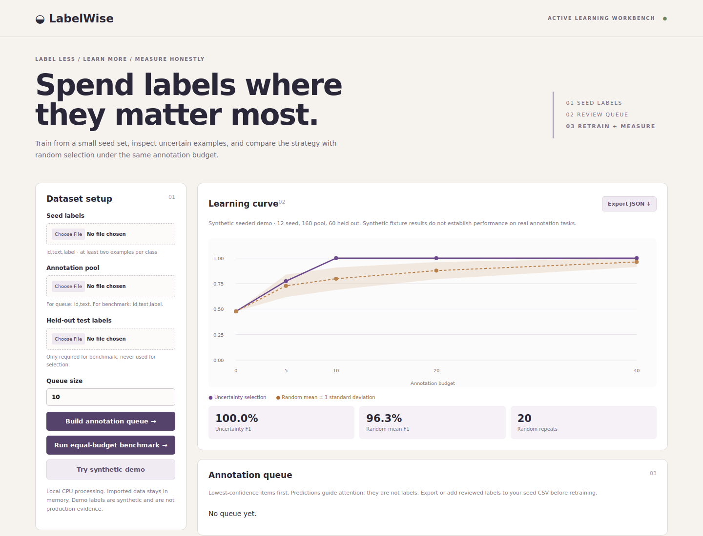

# LabelWise

**Spend labels where they matter most.** LabelWise is a local text-classification active-learning assistant. Start with a small labelled seed, rank unlabelled records by model uncertainty, review them, add human labels, and retrain. A reproducible benchmark compares least-confidence sampling with random selection under identical annotation budgets on a held-out labelled test set.

It does **not** auto-label records. Predictions and confidence only prioritise human review.

## Quick start

Python 3.11+ (tested with 3.12), CPU only, no API key or paid service.

```sh
git clone --branch feat/labelwise-mvp https://github.com/oshada28nilendra-debug/labelwise.git
cd labelwise
python -m venv .venv
source .venv/bin/activate  # Windows PowerShell: .venv\Scripts\Activate.ps1
python -m pip install -r requirements-lock.txt
python -m pip install -e . --no-deps
labelwise serve
```

Open http://127.0.0.1:8768 and click **Try synthetic demo**.



## Annotation workflow

Prepare a labelled seed CSV and unlabelled pool CSV:

```csv
id,text,label
s-1,"refund was not received",billing
s-2,"invoice charged twice",billing
s-3,"password reset fails",access
s-4,"cannot sign in",access
```

```csv
id,text
p-1,"account verification loop"
p-2,"card charged after cancellation"
```

Upload both, build the queue, and review the lowest-confidence items first. Predictions are suggestions, never ground truth. Add reviewed `id,text,label` rows to the seed CSV, remove those IDs from the pool, and rerun; the model is refit from scratch. This explicit file workflow makes the human decision and data lineage visible. Browser state is not persistent, so save your files and exports.

Every seed class needs at least two examples. IDs and exact text must not overlap across splits; duplicate text within a split is allowed but may overweight it. Input is strict UTF-8 CSV, at most 5 MiB and 5,000 rows per file; IDs ≤100 characters, text ≤10,000, labels ≤100. The browser holds inputs in memory and binds only to localhost.

CLI queue:

```sh
labelwise queue --seed labelwise/sample/seed.csv \
  --pool labelwise/sample/pool-unlabelled.csv --size 10 --output queue.json
```

## Honest benchmark

Benchmark files use `id,text,label` for seed, pool and test. Pool labels simulate an annotation oracle: selection cannot access them, and each label is revealed only after its record is selected. Test labels are never used for selection or training.

```sh
labelwise benchmark --seed labelwise/sample/seed.csv \
  --pool labelwise/sample/pool-labelled.csv --test labelwise/sample/test.csv \
  --budgets 0 5 10 20 40 --repeats 20 --output reports/benchmark.json
```

The classifier is class-balanced logistic regression over word unigram/bigram TF-IDF (maximum 20,000 features). It is refit after every acquired label. Uncertainty is `1 − max predicted class probability`; ties use ID order. The random baseline uses 20 deterministic permutations (seed 42) with exactly the same budgets. Metrics are held-out accuracy and macro F1. Random standard deviation describes these 20 runs; it is not a confidence interval. Scores are not calibrated probabilities.

## Measured synthetic result — 2026-10-12

The bundled fixture is authored synthetic support-ticket text: 12 seed examples (4/class), 168 pool items and 60 held-out test items across access, billing and technical categories. It is deliberately repetitive and easy, with no independent annotators or real class ambiguity. No hyperparameters were tuned against its test set.

| Budget | Uncertainty macro F1 | Random macro F1 mean ± SD |
|---:|---:|---:|
| 0 | 0.4773 | 0.4773 ± 0.0000 |
| 5 | 0.7743 | 0.7280 ± 0.1108 |
| 10 | 1.0000 | 0.7983 ± 0.1104 |
| 20 | 1.0000 | 0.8778 ± 0.0842 |
| 40 | 1.0000 | 0.9626 ± 0.0496 |

[Full report](reports/synthetic-benchmark.json). Exact text overlap across splits is rejected and the report fingerprints all three datasets. Uncertainty reaches perfect macro F1 at budget 10, while the random mean is 0.7983; this reflects this simple authored vocabulary, not a general advantage. Adding labels does not guarantee monotonic improvement. This demonstration proves pipeline behaviour, **not** annotation savings on real data. Repeatedly consulting the test curve while changing the system would leak evaluation information.

## Architecture and limitations

`core.py` validates splits, fits models, ranks queues and runs the simulation. `sample_data.py` creates deterministic fixtures. CLI and stateless Flask routes share the same core; vanilla JS renders charts and records as text. CSP, host checks, bounded requests and no-store headers support the local-only design. The Flask development server is not a public deployment configuration.

Limitations: bag-of-words English-oriented baseline; no embeddings, multi-label tasks, class discovery, annotation database, user accounts, inter-annotator agreement, cost-sensitive budgets, diversity sampling, calibration or drift monitoring. Least confidence can oversample ambiguous noise and redundant examples. Class-balanced training requires known seed classes and cannot discover a class absent from the seed. Small/imbalanced real datasets need independently labelled development and untouched final test splits, repeated acquisition runs, annotation-time measurement, stronger baselines and statistical uncertainty.

## Verification

```sh
python -m pytest -q
npm ci
npx playwright install chromium
# In another terminal: labelwise serve
npm run test:browser
```

Tests cover parser failures, split leakage, seed coverage, deterministic label-free queues, equal budgets, reproducible random trials, empty vocabulary, HTTP guards and CLI behaviour. Browser checks exercise the curve, JSON export, real queue files, confidence evidence, failed-import reset and mobile layout. GitHub Actions runs the suite, measured CLI benchmark and Chromium workflow; check the PR for remote status. See [delivery record](docs/project-status.md).

## Interview explanation

“I built a human-in-the-loop active-learning workflow and protected the evaluation boundary: pool labels stay hidden until acquisition, exact text cannot overlap between splits, the held-out test set never influences selection, and uncertainty is compared with repeated random sampling at equal budgets. The synthetic demo shows a gain at small budgets, but I present it as pipeline verification—not proof that the method saves labels in the real world.”

Synthetic fixtures were authored for this repository; no third-party dataset is redistributed.
